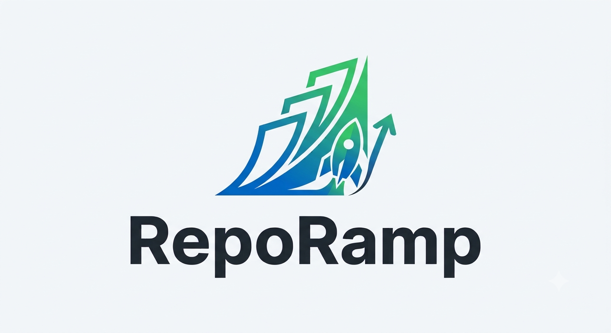

 <div align="center">

<p align="center">
  
</p>

<h1 align="center">RepoRamp</h1>

<p align="center">
  <strong>Scan. Understand. Improve.</strong>
  <br />
  Python Codebase Intelligence
</p>

---

[](https://www.python.org/)
[](LICENSE)
[](#development)

**Turn complex Python repositories into clear, actionable architecture insights.**

RepoRamp scans Python source code, maps internal dependencies, identifies architectural issues, and generates Markdown and JSON reports—all without executing the analyzed source files.

</div>

---

## Overview

Understanding an unfamiliar Python repository can be difficult. Dependencies are spread across files, circular imports can complicate maintenance, and structural issues are not always obvious.

RepoRamp helps developers understand a codebase through static analysis and actionable quality findings.

## Features

| Feature | Description |
|---|---|
| Repository scanning | Discover Python files while excluding common generated and environment directories. |
| AST-based parsing | Extract imports, classes, functions, and methods from Python source. |
| Dependency analysis | Build an internal dependency graph and identify circular dependencies. |
| Quality analysis | Detect empty modules, excessive internal dependencies, and dependency cycles. |
| Markdown reports | Generate readable architecture and quality reports. |
| JSON reports | Export structured analysis data for automation and integrations. |
| CLI | Analyze repositories directly from your terminal. |

## Quality Rules

| Rule ID | Finding | Default severity |
|---|---|---|
| QR001 | Module contains no meaningful statements | Warning |
| QR002 | Module has too many distinct internal dependencies | Warning |
| QR003 | Circular dependency detected | Warning |

The excessive-dependency rule uses a default threshold of five distinct dependencies. A warning is a signal to investigate, not proof that the code is defective.

## Quick Start

### Requirements

- Python version supported by the project configuration
- Git
- Windows PowerShell, macOS, or Linux terminal

### Installation

```powershell
git clone https://github.com/launchforgedev/RepoRamp.git
cd RepoRamp

python -m venv .venv
```

Activate the environment on Windows PowerShell:

```powershell
.venv\Scripts\Activate.ps1
```

Install RepoRamp in editable mode:

```powershell
pip install -e .
```

### Analyze a repository

Display the available commands:

```powershell
reporamp --help
```

Analyze the current repository:

```powershell
reporamp analyze . --output reporamp-report
```

Analyze another repository:

```powershell
reporamp analyze "C:\path\to\your\project" --output reporamp-report
```

## Generated Reports

RepoRamp generates two files in the selected output directory:

- **`report.md`** — human-readable architecture analysis, dependencies, cycles, and quality findings.
- **`report.json`** — structured analysis data suitable for scripts and other tools.

Example JSON quality finding:

```json
{
  "rule_id": "QR002",
  "severity": "warning",
  "message": "Module depends on 6 internal modules",
  "module": "reporamp.cli",
  "suggestion": "Review the module's responsibilities and consider splitting it into smaller modules"
}
```

The example illustrates the output format; actual findings depend on the repository being analyzed.

## How It Works

1. **Scan** — discover Python source files.
2. **Parse** — use Python's AST to inspect source structure without running the source code.
3. **Analyze** — resolve internal imports and build a dependency graph.
4. **Evaluate** — apply the available quality rules.
5. **Report** — export architecture information and findings to Markdown and JSON.

## Development

Clone the repository and install it in a virtual environment as described above.

Run the test suite:

```powershell
pytest
```

Run an analysis against the repository itself:

```powershell
reporamp analyze . --output test-report
```

Contributions and bug reports are welcome through the repository's GitHub page.

## Roadmap

Potential future improvements include additional quality rules, richer architecture visualizations, configurable rule thresholds, and optional AI-assisted explanations.

## License

RepoRamp is licensed under the Apache License 2.0. See [LICENSE](LICENSE) for details.

---

<div align="center">

**Built for developers who want to understand their codebases better.**

</div>